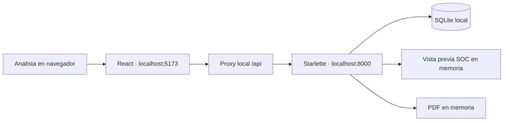

# SOC L2 | Threat Investigation Platform

Plataforma académica de investigación SOC Nivel 2 para importar registros, explorar evidencia, ejecutar detecciones verificables en vista previa y generar informes técnicos y ejecutivos PDF.

Proyecto final del **Bootcamp Analista SOC Nivel 2 de Comunidad DOJO y WoSEC Panamá**. Funciona exclusivamente en Windows mediante localhost. Su propósito es demostrar un proceso de análisis trazable: **registro original → regla → alerta preliminar → evidencia → investigación del analista**.

El proyecto implementa un laboratorio funcional; su alcance y sus reglas requieren validación humana. Una alerta no acredita un ataque ni equivale a un incidente confirmado.

## Funcionalidades

- **Resumen:** métricas agregadas de SQLite y cuatro gráficos Recharts de severidad original, fuentes, hosts y autenticación reconocida. Contadores de alertas solamente cuando existe una vista previa válida.
- **Eventos:** búsqueda, filtros, paginación y detalle de valores originales, Log_ID, archivo, fila, hash y contexto temporal.
- **Investigaciones:** ejecución manual de cinco reglas deterministas, prioridad justificada y evidencia vinculada. Vista previa de solo lectura, sin sobrescribir casos anteriores.
- **Importar registros:** CSV/XLSX por acción explícita; validación de archivo, mapeo de campos, procedencia y conteos de aceptados, duplicados y rechazados. Importar no activa detecciones.
- **Informes:** PDF ejecutivo y técnico con alcances diferentes. La inclusión de una vista SOC es explícita y se verifica en el servidor; exportar no ejecuta reglas.
- **Configuración:** estado del backend local y diagnóstico de comunicación.

La interfaz Enterprise Dark incluye navegación por teclado, menú contraíble, navegación móvil y estados de carga, vacío y error. Al iniciar una copia nueva, el dataset está vacío: las tarjetas indican el estado real y las acciones que requieren evidencia permanecen pendientes o deshabilitadas. No se precargan los datos privados usados durante el desarrollo.

## Tecnologías y arquitectura

| Capa | Tecnologías |
| --- | --- |
| Interfaz | React, TypeScript, Vite, Tailwind CSS, Lucide React, Recharts |
| API local | Python, Starlette, Uvicorn |
| Datos | SQLite; lectura CSV con la biblioteca estándar y XLSX con openpyxl |
| Informes | ReportLab, tipografías incluidas en la dependencia |
| Validación | unittest, Vitest, Testing Library, jsdom, TypeScript |



Frontend y backend están separados. La API usada por React permanece en Starlette; FastAPI/Pandas son una posibilidad de evolución, no dependencias de la implementación actual. No hay hosting, dominio, servicios externos ni autenticación implementada para proteger datos multiusuario.

```text
app/                        Backend, almacenamiento, reglas y generadores PDF
frontend/                   React, servicios tipados y pruebas de interfaz
tests/                      Pruebas backend con bases temporales
scripts/                    Auditor de solo lectura y generador sintético heredado
samples/                    Un CSV sintético verificado para pruebas del prototipo
docs/                       Documentación pública y plan; informes internos excluidos
assets/screenshots/         Instrucciones para capturas reales revisadas
static/                     Prototipo anterior conservado
data/                       Base y archivos locales: excluidos de Git
artifacts/                  Auditorías y salidas privadas: excluidos de Git
```

## Requisitos

- Windows y PowerShell, sin permisos de administrador.
- Python **3.13** con `venv` y `pip`.
- Node.js **22.12 o superior**, npm y Git para obtener/versionar una copia.
- Chrome, Brave o navegador equivalente para usar la aplicación.

La validación de desarrollo se realizó con Python 3.13.17, Node 24.22.1 y npm 11.19.1. Las versiones declaradas de Python están en `requirements.txt`; el frontend utiliza `package-lock.json`. Las dependencias Python admiten intervalos: todavía no se garantiza una reproducción idéntica en todas sus versiones futuras.

El Excel privado del Bootcamp, una cuenta de GitHub y credenciales de servicios no son necesarios para iniciar la aplicación. La instalación de dependencias requiere acceso a sus registros si no están disponibles en caché; la ejecución utiliza servicios locales.

## Instalación en una copia nueva

Después de obtener la carpeta del proyecto, abrir PowerShell **en su raíz**, donde se encuentran `app/` y `requirements.txt`:

```powershell
python -m venv .venv
.\.venv\Scripts\python.exe -m pip install -r requirements.txt
```

En otra terminal, dentro de `frontend/`:

```powershell
npm ci
```

Usar el `.venv` existente si ya se preparó este proyecto. No es necesario activarlo ni cambiar ExecutionPolicy. Si la instalación falla por red o permisos, conservar estas tecnologías y resolver el error antes de arrancar; no se requiere desactivar protecciones de Windows.

## Iniciar y detener en Windows

**Terminal 1 — raíz del proyecto, copia nueva:**

```powershell
.\.venv\Scripts\python.exe -B -m uvicorn app.main:app --host 127.0.0.1 --port 8000
```

El arranque inicial crea el esquema vacío en `data/soc.db`; no importa archivos ni ejecuta detecciones. Para una base existente ya inicializada que deba mantenerse fuera del inicializador de esquema, utilizar en su lugar:

```powershell
.\.venv\Scripts\python.exe -B -m uvicorn app.main:app --host 127.0.0.1 --port 8000 --lifespan off
```

No usar `--lifespan off` con una copia que todavía no tenga el esquema. No borrar una base existente para solucionar un problema de conexión.

**Terminal 2 — desde la raíz:**

```powershell
cd frontend
npm run dev -- --configLoader native
```

Abrir **http://127.0.0.1:5173/**. Vite utiliza un proxy restringido para `/api`; ambos servidores escuchan en `127.0.0.1`. El puerto 8000 conserva el prototipo anterior y no es la dirección de la interfaz React.

**Terminal de comprobación:**

```powershell
Invoke-RestMethod http://127.0.0.1:8000/api/health
Invoke-RestMethod http://127.0.0.1:5173/api/health
```

Ambas respuestas deben ser JSON con `status: ok`. Si el proxy no alcanza Python, muestra HTTP 502 con explicación. Si un puerto ya está ocupado, identificar el servicio en su terminal antes de reiniciarlo. No cerrar indiscriminadamente todos los procesos Node/Python.

Detener cada servidor con **Ctrl+C en su propia terminal**. Reiniciar Vite después de cambios de configuración, también cuando se usa `configLoader native`. Si PowerShell no encuentra npm, abrir una terminal con la instalación de Node en PATH; puede utilizarse `npm.cmd` para evitar depender de un script `npm.ps1`.

Para revisar el build local, con el backend activo y después de compilar:

```powershell
npm run build -- --configLoader native
npm run preview -- --configLoader native
```

Estos comandos se ejecutan en `frontend/`. Abrir **http://127.0.0.1:4173/**; conserva el proxy local y no publica el sitio. En la validación 5A, una instalación frontend limpia desde caché compiló y funcionó mediante este preview. Su primer arranque en modo desarrollo falló con «Access is denied» en la resolución de dependencias de esbuild dentro del entorno de ejecución del asistente. Falta confirmar ese arranque desde PowerShell normal en otra copia; no se estableció una causa definitiva ni se cambiaron protecciones para eludirlo.

Opciones locales existentes: `SOC_DATA_DIR` permite seleccionar otro directorio de datos y `SOC_TIMEZONE` configura la zona del servidor/prototipo. Esta última **no documenta la zona de los logs**. No se necesita un archivo `.env` y el backend no lo carga automáticamente. No poner secretos en variables `VITE_*`.

## Uso de los módulos

1. **Configuración:** confirmar backend disponible. **Resumen:** revisar el estado vacío o las métricas del dataset realmente importado.
2. **Importar registros:** seleccionar un `.csv` o `.xlsx`, revisar el mapeo y declarar zona solamente si existe evidencia para hacerlo. El archivo se envía al pulsar Importar. Revisar aceptados, duplicados y rechazados; la carga es aditiva.
3. **Eventos:** buscar y filtrar registros, abrir el detalle y contrastar los originales y su procedencia. Los campos compatibles incluyen `Log_ID`, `Timestamp`, `Hostname`, `Event_ID`, `User`, `Source_IP`, `Destination`, `Log_Source`, `Event_Description`, `Process_CommandLine`, `Result` y `Severity`.
4. **Investigaciones:** ejecutar manualmente la vista. La hipótesis de relojes comparables empieza desmarcada. Examinar cobertura, prioridad, evidencia y explicaciones benignas antes de emitir una conclusión.
5. **Informes:** generar el técnico o ejecutivo. Sin una vista seleccionada aparece «Detecciones no evaluadas». Para incluir alertas, ejecutar una vista válida y marcar su inclusión; el servidor verifica el dataset y recupera sus propias evidencias.

Una recarga del navegador pierde la vista en la sesión React; el servidor conserva un número limitado de vistas durante 30 minutos en RAM. Reiniciar Python las pierde. Una referencia vencida o de otro dataset produce un error; no se recalcula silenciosamente.

## Metodología SOC

| Regla existente | Comportamiento y umbral | Dependencia |
| --- | --- | --- |
| AUTH-001 | Al menos 5 fallos del mismo origen, usuario y host en 5 minutos | Ventana temporal comparable |
| AUTH-002 | Éxito precedido de al menos 5 fallos del mismo origen, usuario y host en 10 minutos | Ventana temporal comparable |
| AUTH-003 | Fallos contra al menos 5 usuarios desde una IP en 10 minutos | Ventana temporal comparable |
| NET-001 | Al menos 10 puertos de destino distintos hacia el mismo destino en 2 minutos | Campos estructurados y base temporal |
| EXEC-001 | Indicadores sospechosos de PowerShell/pwsh o evento 4104: codificación, descarga, ejecución dinámica o bypass | Evidencia de comando; sin intervalo obligatorio |

Las reglas deterministas producen señales e hipótesis. La prioridad calculada y su justificación se presentan por separado de la `Severity` original; el puntaje heurístico no es una probabilidad de compromiso. Cada alerta conserva vínculos con los eventos que la sustentan, limitaciones y posibles falsos positivos.

Los timestamps sin offset o declaración de zona muestran **«Zona no indicada»**. No se convierten en UTC por ubicación del equipo. Las ventanas sin zona se omiten salvo hipótesis explícita del analista sobre comparabilidad de relojes del ámbito seleccionado; esa hipótesis no demuestra sincronización ni establece una zona. El dataset privado auditado durante el desarrollo contenía 715 registros sin zona documentada y no se distribuye con el proyecto.

El flujo React trabaja con vistas preliminares: no implementa confirmación persistente del analista ni reemplaza investigaciones anteriores. Los logs se tratan como datos no confiables; sus comandos no se ejecutan ni decodifican automáticamente.

## Capturas y presentación

No se incluyen capturas fabricadas ni imágenes con evidencia privada sin autorización. Estas ubicaciones quedan preparadas para capturas reales:

| Pantalla | Archivo previsto | Estado |
| --- | --- | --- |
| Resumen con gráficos | `assets/screenshots/dashboard.png` | Pendiente de captura real y revisión |
| Explorador de eventos | `assets/screenshots/eventos.png` | Pendiente de captura real y revisión |
| Investigación y evidencia | `assets/screenshots/investigaciones.png` | Pendiente de captura real y revisión |
| Informes / documento PDF | `assets/screenshots/informes.png` | Pendiente de captura real y revisión |

Las imágenes permanecen excluidas por defecto. Ver [criterios de capturas](assets/screenshots/README.md), [índice de documentación](docs/README.md) y [guía de futura publicación](docs/PUBLICATION_GUIDE.md).

## Pruebas y build

Desde la raíz:

```powershell
.\.venv\Scripts\python.exe -B -m unittest discover -s tests -q
```

Desde `frontend/`:

```powershell
npm run typecheck
npm test -- --configLoader native
npm run build -- --configLoader native
```

Última validación 5A: **89 pruebas backend, 84 frontend, TypeScript y build aprobados**, tanto en el árbol original como en una copia de las fuentes publicables. El frontend de la copia se instaló mediante `npm ci --offline` desde una copia de la caché existente; Python reutilizó el `.venv` instalado. No se comprobó una instalación Python independiente desde Internet ni otro equipo. En un primer pase simultáneo con el build, dos pruebas de Dashboard agotaron su tiempo; la repetición completa sin ese build aprobó 84/84, sin cambiar pruebas ni timeouts. La limitación del modo desarrollo de esa copia se describe arriba.

La suite utiliza bases temporales y fixtures sintéticos: no necesita el Excel privado. Los dos PDF dentro de `frontend/src/test/fixtures/` son contratos sintéticos para pruebas y no documentos de evidencia del usuario.

Un build o una prueba DOM no sustituye la inspección visual en navegador. El diseño fue revisado por el usuario; los alcances de cada nueva comprobación deben declararse expresamente.

## Seguridad y limitaciones

- Ámbito académico local; no se ha evaluado como producto SOC comercial ni como servicio expuesto a Internet.
- Cinco reglas con campos y umbrales específicos; una omisión o ausencia de alertas no demuestra ausencia de amenazas.
- Sin validación automática de autenticidad del emisor ni cadena de custodia inmutable. SHA-256 identifica contenido; la procedencia depende de lo conservado al importar.
- Sin confirmación persistente de incidentes desde React, autenticación multiusuario o IA generativa integrada en ejecución.
- El código legado de análisis asistido permanece conservado, sin uso por la nueva interfaz; no se instala ni integra Ollama/Qwen. Las rutas antiguas de demostración/análisis no forman parte del flujo recomendado. No usar acciones de reinicio del prototipo sobre evidencia propia.
- Las validaciones históricas, bases, informes con evidencia y rutas personales se conservan localmente, excluidos del paquete público. `.gitignore` no elimina archivos ya comprometidos ni protege un envío forzado; revisar el contenido y el historial antes de publicar.
- Pendientes: rúbrica final del Bootcamp, elección de licencia/autorización de publicación, capturas revisadas y demostración grabada. No se concede una licencia de distribución mediante este README.

## Créditos

Proyecto académico del Bootcamp Analista SOC Nivel 2 de **Comunidad DOJO y WoSEC Panamá**. **OpenAI Codex se utilizó como asistente de programación, revisión y depuración**. El análisis de la aplicación utiliza reglas verificables; no se presenta como IA generativa. El criterio y la confirmación de hallazgos corresponden al analista.
